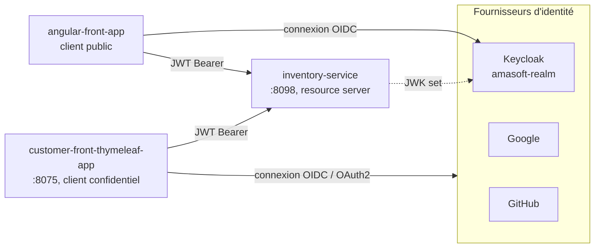

<p align="right"><a href="README.md">EN</a> | <b>FR</b></p>

# Spring & Angular avec OAuth2 / OpenID Connect

Sécurisation d'un microservice Spring Boot et de deux front-ends (Angular et Thymeleaf) avec OAuth2 et OpenID Connect, en utilisant Keycloak comme fournisseur d'identité et Google et GitHub comme connexions sociales.


## Architecture



| Module | Rôle |
|---|---|
| **inventory-service** | API REST des produits, configurée en resource server OAuth2. Valide les JWT Keycloak et convertit les rôles du realm en autorités Spring (`JwtAuthConverter`). |
| **customer-front-thymeleaf-app** | Application web côté serveur (client OAuth2) : connexion via Keycloak, Google ou GitHub, pages protégées par rôle, appels à l'API avec le token de l'utilisateur. |
| **angular-front-app** | SPA Angular avec `keycloak-angular` : connexion, garde de routes par rôle, intercepteur HTTP qui ajoute le token aux appels API. |

## Fonctionnalités de sécurité

- **Flux Authorization Code** avec Keycloak pour les deux front-ends ; l'application Angular est un client public, l'application Thymeleaf un client confidentiel.
- **Plusieurs fournisseurs d'identité** dans la même application : Keycloak, Google et GitHub, avec une page de connexion personnalisée.
- **Mapping des rôles :** rôles Keycloak issus de l'ID token ou du JWT convertis en `GrantedAuthority` ; endpoints protégés par `@PreAuthorize("hasAuthority('ADMIN')")`.
- **Propagation du token :** l'application Thymeleaf transmet le token de l'utilisateur au resource server via `RestClient`.
- **Déconnexion OIDC** (initiée par le client) : la déconnexion de l'application ferme aussi la session Keycloak.
- **Angular :** `AuthGuard` sur les routes selon les rôles, vérification SSO silencieuse (`silent-check-sso.html`).

## Démarrage

1. Lancer Keycloak (par exemple `docker run -p 8080:8080 -e KEYCLOAK_ADMIN=admin -e KEYCLOAK_ADMIN_PASSWORD=admin quay.io/keycloak/keycloak start-dev`), puis créer le realm `amasoft-realm`, les clients `amasoft-app-1` (confidentiel) et `amasoft-angular-app` (public), et un rôle `ADMIN`.
2. Définir les variables d'environnement de l'application Thymeleaf :

   | Variable | Description |
   |---|---|
   | `KEYCLOAK_URL` | URL de Keycloak (par défaut `http://localhost:8080`) |
   | `KEYCLOAK_CLIENT_SECRET` | Secret du client `amasoft-app-1` |
   | `GOOGLE_CLIENT_ID` / `GOOGLE_CLIENT_SECRET` | Identifiants OAuth Google |
   | `GITHUB_CLIENT_ID` / `GITHUB_CLIENT_SECRET` | Identifiants de l'OAuth App GitHub |

3. Lancer les services :

   ```bash
   cd inventory-service && ./mvnw spring-boot:run
   cd customer-front-thymeleaf-app && ./mvnw spring-boot:run
   cd angular-front-app && npm install && npm start
   ```

| Application | URL |
|---|---|
| Application Thymeleaf | http://localhost:8075 |
| Application Angular | http://localhost:4200 |
| API inventaire | http://localhost:8098/products |
