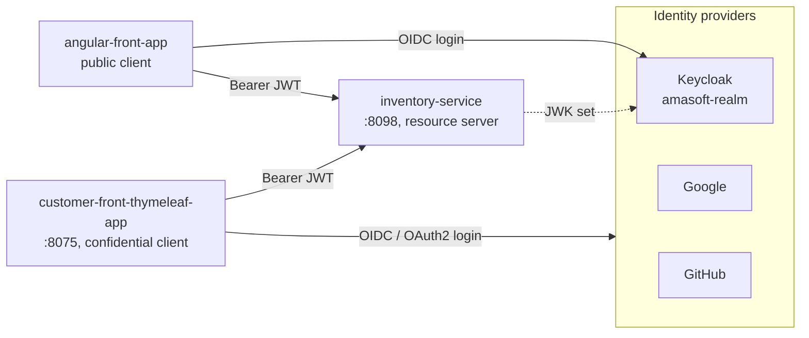

<p align="right"><b>EN</b> | <a href="README.fr.md">FR</a></p>

# Spring & Angular with OAuth2 / OpenID Connect

Securing a Spring Boot microservice and two front ends (Angular and Thymeleaf) with OAuth2 and OpenID Connect, using Keycloak as the identity provider and Google and GitHub as social logins.


## Architecture



| Module | Role |
|---|---|
| **inventory-service** | REST API exposing products, configured as an OAuth2 resource server. Validates Keycloak JWTs and maps realm roles to Spring authorities (`JwtAuthConverter`). |
| **customer-front-thymeleaf-app** | Server-side web app (OAuth2 client): login with Keycloak, Google or GitHub, role-based pages, calls the API with the user's token. |
| **angular-front-app** | Angular SPA using `keycloak-angular`: login, route guard by role, HTTP interceptor adding the token to API calls. |

## Security features

- **Authorization Code flow** with Keycloak for both front ends; the Angular app runs as a public client, the Thymeleaf app as a confidential client.
- **Several identity providers** in the same app: Keycloak, Google and GitHub, with a custom login page.
- **Role mapping:** Keycloak roles from the ID token or JWT converted to `GrantedAuthority`; endpoints protected with `@PreAuthorize("hasAuthority('ADMIN')")`.
- **Token propagation:** the Thymeleaf app forwards the user's token to the resource server with `RestClient`.
- **OIDC logout** (RP-initiated): logging out of the app also ends the Keycloak session.
- **Angular:** `AuthGuard` on routes based on roles, silent SSO check (`silent-check-sso.html`).

## Getting started

1. Start Keycloak (for example `docker run -p 8080:8080 -e KEYCLOAK_ADMIN=admin -e KEYCLOAK_ADMIN_PASSWORD=admin quay.io/keycloak/keycloak start-dev`), then create the `amasoft-realm` realm, the `amasoft-app-1` (confidential) and `amasoft-angular-app` (public) clients, and an `ADMIN` role.
2. Set the environment variables used by the Thymeleaf app:

   | Variable | Description |
   |---|---|
   | `KEYCLOAK_URL` | Keycloak base URL (default `http://localhost:8080`) |
   | `KEYCLOAK_CLIENT_SECRET` | Secret of the `amasoft-app-1` client |
   | `GOOGLE_CLIENT_ID` / `GOOGLE_CLIENT_SECRET` | Google OAuth credentials |
   | `GITHUB_CLIENT_ID` / `GITHUB_CLIENT_SECRET` | GitHub OAuth app credentials |

3. Run the services:

   ```bash
   cd inventory-service && ./mvnw spring-boot:run
   cd customer-front-thymeleaf-app && ./mvnw spring-boot:run
   cd angular-front-app && npm install && npm start
   ```

| Application | URL |
|---|---|
| Thymeleaf app | http://localhost:8075 |
| Angular app | http://localhost:4200 |
| Inventory API | http://localhost:8098/products |
